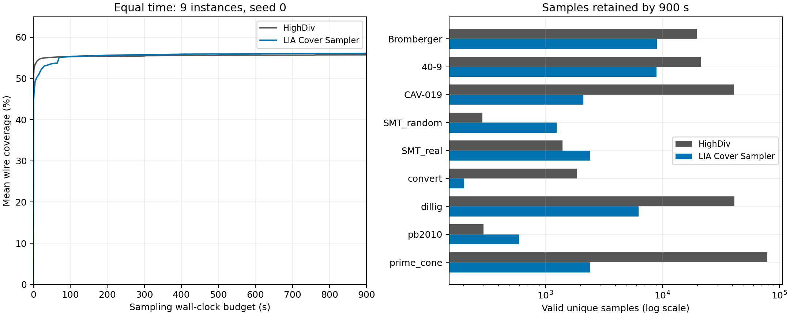
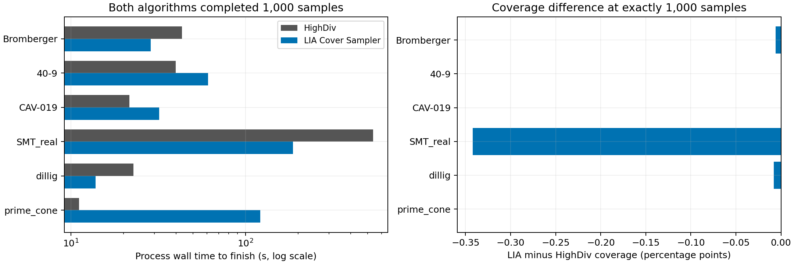

# 900 秒固定时间与 1000 样本目标实验报告

本轮完成两个独立实验组：每个案例分别运行 HighDiv 和 LIA Cover Sampler，共 4 个批次、36 次运行。结果来自用户完成的实验，本次整理没有重新运行采样器。

**LIA 在固定 900 秒的全九案例平均覆盖率上领先 0.373 个百分点，但 HighDiv 产出约 6.21 倍的有效不同样本。严格比较双方都达到 1000 个样本的六个案例时，LIA 平均覆盖率低 0.059 个百分点，没有实现固定时间与相同样本数下的覆盖率双提升。** 全集的覆盖提升主要来自开发集中的 convert 案例；既定六个评测案例的平均覆盖率没有提高。

## 实验设置与可信范围

只使用 benchmarks 中原有九个案例，保留原来的三个开发案例和六个评测案例划分。两种算法均为种子 0，每个批次设置 12 个工作槽位、求解器单线程；当前每批九个任务，因此最多同时运行九个采样进程。四批依次运行，覆盖率审计使用最多 12 个独立进程。

| 组别 | 样本上限 | 每次运行时间上限 | 实际结束情况 |
|---|---:|---:|---|
| 相同时间 | 4,294,967,295，实际不构成限制 | 900 秒 | 两算法的 18 次运行均在硬截止结束 |
| 相同个数目标 | 1000 | 900 秒 | 两算法分别 7 次达到 1000，2 次超时保留部分样本 |

覆盖率采用冻结的 HighDiv 原始 wire coverage。本文“平均覆盖率”是逐案例百分比的算术平均，各案例等权；不是把所有节点合并后计算的百分比。相同个数目标组的九案例终点仍包含未满 1000 的运行，必须与真正的等数量前缀比较区分。

二进制与之前测量一致，SHA-256 均与 dependencies 中的构建记录相符：HighDiv 为原设置 -O0 加样本 flush/时间戳；LIA 为 -O3，使用相同冻结 Z3。编译配置不同、仅单种子且批次间系统负载未完全隔离，因此不能把差异全部归因于算法，也不能宣称统计显著或普遍领先。此前 30 秒、三种子的结果不能直接与本轮单种子纯时间实验混为一组。

## 相同时间：900 秒

| 指标 | HighDiv | LIA Cover Sampler |
|---|---:|---:|
| 全九案例平均覆盖率 | 55.7331% | 56.1061% |
| 六个评测案例平均覆盖率 | 61.2733% | 61.2541% |
| 预算内有效不同样本总数 | 206,438 | 33,254 |
| 每案例样本数中位数 | 19,770 | 2,412 |
| LIA 覆盖率胜 / 平 / 负 | — | 2 / 5 / 2 |

LIA 全集平均领先 0.3731 个百分点，六个评测案例平均落后 0.0192 个百分点。HighDiv 的样本总产量是 LIA 的 6.21 倍；这是该九案例合计的产量比例，不代表每个案例都更快。

| 案例缩写 | 划分 | HighDiv 样本数 | LIA 样本数 | HighDiv 覆盖率 | LIA 覆盖率 | LIA 差值（百分点） |
|---|---|---:|---:|---:|---:|---:|
| Bromberger | 开发 | 19,770 | 8,995 | 96.3820% | 96.3820% | 0 |
| 40-9 | 评测 | 21,509 | 8,958 | 96.3293% | 96.3293% | 0 |
| CAV-019 | 评测 | 41,155 | 2,120 | 78.3971% | 78.3971% | 0 |
| SMT_random | 开发 | 291 | 1,250 | 12.9053% | 12.5680% | -0.3374 |
| SMT_real | 评测 | 1,406 | 2,412 | 11.5636% | 11.4092% | -0.1544 |
| convert | 开发 | 1,881 | 203 | 24.6707% | 28.4810% | +3.8103 |
| dillig | 评测 | 41,351 | 6,300 | 93.8440% | 93.8440% | 0 |
| pb2010 | 评测 | 297 | 596 | 4.1067% | 4.1458% | +0.0391 |
| prime_cone | 评测 | 78,778 | 2,420 | 83.3990% | 83.3990% | 0 |

完整文件名见 [逐案例配对表](../results/analysis_900s/paired_endpoints.csv)。最明显的优势在 convert：LIA 用 203 个样本覆盖 28.4810%，超过 HighDiv 用 1881 个样本得到的 24.6707%。另一方面，SMT_random 和 SMT_real 上 LIA 虽然生成更多样本，覆盖率仍略低，说明样本数量与覆盖质量不能互相替代。

五个覆盖相同的案例中，HighDiv 都生成了更多样本，但最终没有新增覆盖优势。这提示继续采样存在覆盖收益递减；这里只比较观测到的覆盖，不把两者相等当作已经证明达到理论最大覆盖。

| 已用时间 | HighDiv 平均覆盖率 | LIA 平均覆盖率 |
|---|---:|---:|
| 5 秒 | 53.4113% | 49.3069% |
| 30 秒 | 54.9783% | 53.0388% |
| 60 秒 | 55.1697% | 53.7096% |
| 120 秒 | 55.3208% | 55.4074% |
| 300 秒 | 55.4660% | 55.7675% |
| 900 秒 | 55.7331% | 56.1061% |

HighDiv 的早期覆盖增长更快；在这些保存的时间点中，LIA 从 120 秒开始略高。长预算终点的优势不意味着短预算性能也更好。

## 相同个数目标：1000 个，最多 900 秒

| 指标 | HighDiv | LIA Cover Sampler |
|---|---:|---:|
| 达到 1000 个的案例数 | 7 / 9 | 7 / 9 |
| 全九案例有效不同样本总数 | 7,690 | 7,828 |
| 全九案例终点平均覆盖率，包含超时 | 55.5820% | 56.1128% |
| 六个评测案例终点平均覆盖率，包含超时 | 61.2755% | 61.2243% |
| 双方均达到 1000 的同六案例平均覆盖率 | 76.6515% | 76.5922% |
| 同六案例完成进程的平均墙钟时间 | 112.71 秒 | 73.87 秒 |

九案例终点平均覆盖率 LIA 高 0.5308 个百分点，但该行并非严格相同样本数的比较。两算法各有两例超时，而且超时案例集合不同。

| 案例缩写 | HighDiv 样本数 | LIA 样本数 | HighDiv 耗时（秒） | LIA 耗时（秒） | HighDiv 覆盖率 | LIA 覆盖率 |
|---|---:|---:|---:|---:|---:|---:|
| Bromberger | 1000 | 1000 | 43.23 | 28.61 | 96.3820% | 96.3761% |
| 40-9 | 1000 | 1000 | 39.87 | 60.88 | 96.3293% | 96.3293% |
| CAV-019 | 1000 | 1000 | 21.58 | 32.07 | 78.3971% | 78.3971% |
| SMT_random | 355 | 1000 | 900.00（超时） | 519.23 | 12.9254% | 12.5670% |
| SMT_real | 1000 | 1000 | 537.71 | 186.71 | 11.5575% | 11.2154% |
| convert | 1000 | 216 | 411.60 | 900.01（超时） | 23.2780% | 28.7264% |
| dillig | 1000 | 1000 | 22.78 | 13.82 | 93.8440% | 93.8361% |
| pb2010 | 335 | 612 | 900.01（超时） | 900.03（超时） | 4.1261% | 4.1689% |
| prime_cone | 1000 | 1000 | 11.10 | 121.11 | 83.3990% | 83.3990% |

耗时来自进程墙钟记录，包含终止与回收的少量延迟；覆盖率只计写出时间戳不超过 900 秒的样本。表中 900.03 秒不是允许采样额外运行 0.03 秒。

真正双方都完成 1000 个的六例是 Bromberger、40-9、CAV-019、SMT_real、dillig、prime_cone。LIA 覆盖率为 **0 胜、3 平、3 负**，平均落后 0.0593 个百分点：Bromberger 少 1 bit、dillig 少 4 bit、SMT_real 少 226 bit。差距总体很小，但不支持“相同样本数下更高覆盖”的结论。

在这六例中，LIA 完成时间为 3 快、3 慢。它在 SMT_real 上从 537.71 秒降到 186.71 秒，但在 prime_cone 上从 11.10 秒增加到 121.11 秒。因此平均时间下降不能解释成所有案例一致加速。

保存的样本序列还允许在不重新采样的情况下严格比较前 k 个样本：

| k | 双方均达到 k 的案例数 | HighDiv 平均覆盖率 | LIA 平均覆盖率 | LIA 胜 / 平 / 负 |
|---:|---:|---:|---:|---|
| 5 | 9 | 40.7235% | 21.4533% | 0 / 0 / 9 |
| 10 | 9 | 50.3212% | 34.7269% | 0 / 0 / 9 |
| 50 | 9 | 55.0977% | 45.9356% | 1 / 0 / 8 |
| 100 | 9 | 55.2455% | 51.4660% | 1 / 1 / 7 |
| 200 | 9 | 55.3569% | 54.9864% | 1 / 1 / 7 |
| 500 | 6 | 76.6427% | 76.5181% | 0 / 2 / 4 |
| 1000 | 6 | 76.6515% | 76.5922% | 0 / 3 / 3 |

各行只平均本行实际可配对的案例。k 从 200 变为 500 时案例集合变小，不能把均值上升完全解释为新增样本的作用。完整前缀时间和评测子集结果见 [paired_prefixes.csv](../results/analysis_900s/paired_prefixes.csv)。

## 实现表现与下一步判断

900 秒组 LIA 的 33,254 个样本中，32,309 个来自阻塞探索，670 个来自全局正增益，266 个来自局部正增益，另有 9 个初始模型。阻塞探索占输出约 97.16%。局部输出虽少，累计贡献 56,114 个新增覆盖 bit；这个跨案例 bit 数是机制诊断量，不是正式的平均覆盖率。

LIA 最后检查点中，全局目标求解与阻塞探索求解合计占已记录阶段时间的 **97.24%**；1000 样本目标组为 **95.63%**。时间组所有运行均为硬截止，检查点会遗漏部分最终耗时，因此这些比例是已记录阶段的分解，不是对全部墙钟时间的精确归因。

这些观测支持的改进方向是：在三个开发案例上优先改善早期输出的覆盖质量、目标与方向匹配以及低收益探索的调度，而非优先优化占时很少的模命中算术。convert 的长预算收益值得保留，但不能用单个开发案例的改善替代评测集整体提升；当前实验也没有新的消融对照，无法把收益严格归因于某一个模块。

## 正确性、归档与复现

- 现有独立审计共验证 255,211 个完整样本，非法、未知、格式错误、重复输出和覆盖计数不一致均为 0；180 个前缀的完整状态/事件差分通过。
- HighDiv 固定时间组的 prime_cone 最后一个样本已写完，但对应时间戳缺失。它是零基索引 78,778 的末尾样本；前 78,778 个时间戳连续完整。该样本未计入预算内结果，因此四批合计计入 255,210 个样本。
- 本次额外检查了每批 manifest/journal 哈希、案例与二进制身份、逐运行审计与 JSON/CSV 汇总的一致性、全部原始样本索引与数量、所有写出时间戳、覆盖曲线单调性以及 LIA 逐样本覆盖和来源贡献总和。这些是对已有结果的一致性检查，未重复启动采样或求解器审计。
- 四批 raw.tar.gz 共 87,642,940 字节，包含 205 个原始文件。打包时对全部归档成员逐一比对原文件 SHA-256；原目录保留，各批 archive.json 保存文件清单与哈希。没有删除低覆盖、超时或缺时间戳记录。
- 原 30 秒冻结基线保留不变，本轮的两种预算使用独立结果目录。

结果入口：

- [HighDiv 固定时间](../results/highdiv_time900/audit_summary.csv)、[LIA 固定时间](../results/lia_time900/audit_summary.csv)。
- [HighDiv 1000 样本目标](../results/highdiv_count1000_t900/audit_summary.csv)、[LIA 1000 样本目标](../results/lia_count1000_t900/audit_summary.csv)。
- [汇总 JSON](../results/analysis_900s/summary.json)、[全部终点](../results/analysis_900s/endpoints.csv)、[汇总表](../results/analysis_900s/aggregate.csv)。
- [时间曲线](../results/analysis_900s/time_curves.csv)、[阶段时间](../results/analysis_900s/stages.csv)、[输出来源](../results/analysis_900s/contributions.csv)、[一致性检查记录](../results/analysis_900s/integrity.json)。

从已提交的压缩包复现分析与图表：

    for run in highdiv_time900 lia_time900 highdiv_count1000_t900 lia_count1000_t900; do
      tar -xzf "results/$run/raw.tar.gz" -C "results/$run"
    done
    python3 scripts/analyze_900s.py --plots

绘图需要 matplotlib；省略 --plots 仍可生成全部表格、JSON 和一致性检查记录。上述命令只读取已保存样本，不重新运行 HighDiv 或 LIA。
