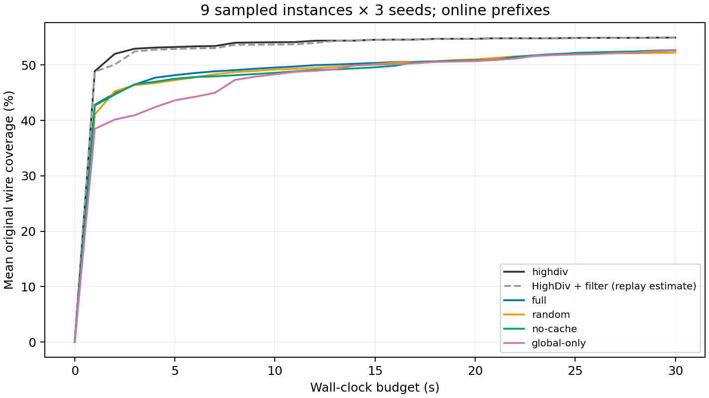
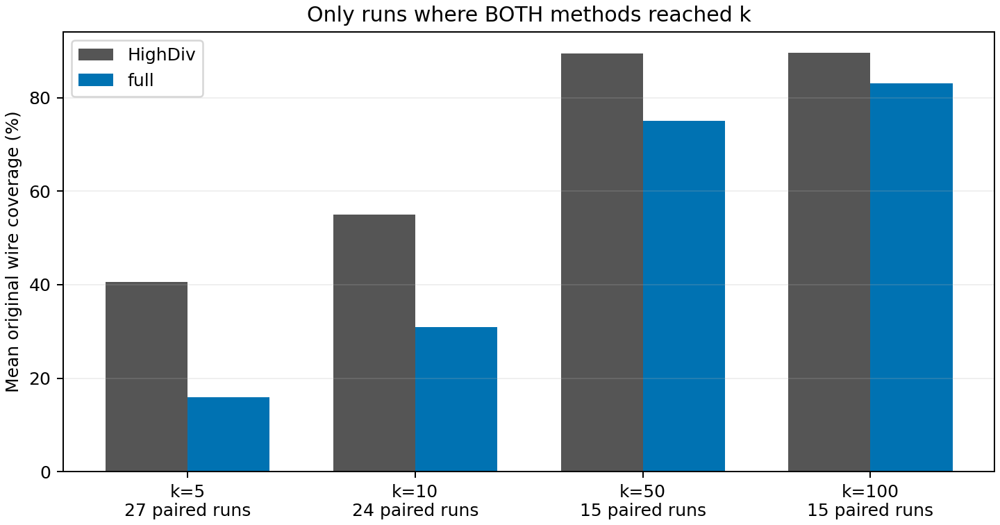

# 第一轮实现与实验报告

本文件保留第一轮 30 秒实验的历史结论。用户后续完成的固定 900 秒和 1000 样本目标两组实验，见 [900 秒实验报告](900秒实验报告.md)；后续批次未覆盖本文件所用的冻结结果。

**实现与正确性验证已完成，但没有实现相同墙钟时间、相同样本数量下的覆盖率双提升。** 本轮完整版本的 30 秒平均原始 wire coverage 为 **52.655%**，冻结 HighDiv 为 **54.969%**；前 10 个不同合法样本的可配对运行中，完整版本也低于 HighDiv。以下保留所有实例、全部种子、失败开发运行及超时前缀，不替换指标、不只选最佳种子。

## 1. 实际完成的工作

- 独立 C++20 实现：安全 Boolean 分支区域、GMP 精确整数/有理运算、完整等式核检查、可行区间、floor-sum 模命中、分排名见证、增量目标打包、集合冲突缓存、独立阻塞探索。
- 原始 DAG 覆盖契约：常量分母、共享节点、短路访问、整数 ite、seen0/seen1、候选与正式覆盖隔离。
- 完整类型模型输出与独立验证；原格式限制显式报告；debug/trace/benchmark；阶段统计、写出时间戳、周期性原子检查点、失败重放。
- 基线一次批次及四组新算法实验，12 路并行。HighDiv 共 27 次调用（9 实例 × 3 种子），之后未再次调用；新增 BASELINE_FROZEN.json 防止意外重跑。
- 逐实例、逐种子、随时间、随样本数的数据，完整原始样本压缩包和中文分析。测量时的核心源码由 v0.1-core-tested 标签保存，运行另有源码/二进制哈希。

没有实现 SMT 内核改造、全局 MaxSMT、LNS、机器学习调度或完整整数格参数化；这些本来就不属于第一版。没有通用自动失败实例缩减器，已发现问题用人工缩减回归测试固定。

## 2. 数据与资源

只使用用户抽出的九个 benchmarks 文件。每个输入的 SHA-256 与事先确定的开发/评测划分见 [manifest](../benchmarks/manifest.json)：哈希排序前三个作开发，余下六个作评测。算法未使用文件名分支。

每次运行严格 30 秒墙钟、最多 1000 个不同输出，种子 0/1/2。采样进程最多并发 12 个，单个 Z3 使用单线程；四组新方法按批次执行。审计使用独立进程隔离 Python/Z3 context。硬截止与运行状态来自外部 runner，不采用 HighDiv 原批处理脚本的额外 65 秒宽限。

这里采用时间和样本数双上限。提前达到 1000 的曲线保持在最后覆盖值，不推测继续采样的结果；因此不能将其解释为不受样本数限制的纯固定时间实验。

HighDiv 源提交固定为 f2c6e1756b13281d96cbf90a8bd940129e56cce4，使用附带 Z3 4.14.2。原始副本与原始 -O0 构建保留；实际测量用独立副本，仅加样本 flush 和写出时间戳，补丁及哈希在 dependencies 中。没有再次运行无插桩副本或 O3 副本。因此“原始 HighDiv”在本报告指采样逻辑不变的计时版本，不声称是未插桩原二进制的额外实测。

新方法为 -O3，HighDiv 为原设置 -O0；插桩 I/O、操作系统调度、最初基线批次期间的少量构建/验证负载没有完全隔离。这些限制使数据适合作第一轮诊断，不足以支持严格的纯算法速度归因。后续若要改变基线资源条件，需要用户另行决定，本轮没有重跑。

## 3. 正确性证据

| 检查 | 结果 |
|---|---|
| 模命中计数、存在性与排名见证 | 8,002 个用例通过，含负系数/截距、bit 63、大整数和巨大区间 |
| 正负整数 floor/ceil 除法 | 2,424 个用例通过 |
| 区域、方向、区间 | 联立等式、无等式、严格不等式、唯一解、无界、Boolean/ite/distinct 及全 E*d=0 检查通过 |
| 全局上下文 | 局部 x=0 不禁用全局 x=1；三元冲突不误伤任意两个目标 |
| unknown/资源耗尽 | 不记录为 UNSAT，不产生永久冲突，增加重试预算 |
| 原评测器差分 | 合成用例及真实运行共 674 个真实样本前缀的完整状态/事件检查通过 |
| 全部正式输出独立验证 | 55,457 个有效；非法、未知、缺变量/错误类型、重复均为 0 |
| 每个新方法输出前缀覆盖整数计数 | 与冻结原评测器一致，差异 0 |
| ASan/UBSan | 核心与 Python 驱动集成测试通过；第三方 Z3 库未以 sanitizer 重编译 |

55,457 是 135 次正式运行的样本总数，不把合成/开发样本混入。检查没有发现缺失时间戳、超预算时间戳或最终不完整行；框架仍单独支持这些异常状态。

HighDiv 自带七个小实例另作新采样器的 1 秒 smoke 检查：4 个实例输出合计 31 个合法样本，3 个在预算内未得到初始模型，明确记作 initial_unknown，未假定全零模型。第一次临时 Python 多线程复核因共享 context 崩溃；复用了六个已完成的输出，仅补完一个未完成的小测试，后续隔离复核通过。正式实验审计始终采用独立进程。

开发 v1 曾发生输出后 context/AST 析构顺序导致的堆损坏；原失败日志与样本保留于 development_v1。修复后的 v2 和全部正式采样无进程错误。上述证据是有限测试和逐模型检查，并非对任意输入的完整形式化证明。

## 4. 固定时间结果

下表为各运行覆盖百分比的算术平均；各实例三个种子，故等价于先对种子平均再对实例平均。样本数取跨运行中位数，不能当作统一的 k。

| 方法 | 全九实例平均覆盖 | 六个评测实例平均覆盖 | 样本数中位数 | 有效不同样本总数 |
|---|---:|---:|---:|---:|
| HighDiv | 54.969% | 61.057% | 615 | 13,226 |
| HighDiv + 统一筛选重放 | 54.955% | 61.057% | 49 | 1,296 |
| 完整版本 | 52.655% | 60.708% | 191 | 9,904 |
| 随机合法参数 | 52.238% | 60.339% | 235 | 11,266 |
| 关闭冲突缓存 | 52.699% | 60.458% | 316 | 11,427 |
| 仅全局目标求解 | 52.621% | 59.875% | 186 | 9,634 |

HighDiv + filter 只重放一次基线保存的序列，接受新增覆盖、新增观察，或连续 32 次停滞后的不同填充。验证与覆盖计算成本实际测量后按顺序累加到候选时间戳；这条曲线是串行时间重建，不是重新执行过的在线包装，也没有测量包装与采样器的 CPU 竞争。其样本数量/覆盖可精确重算，时间结论必须保留此限制。它说明本基线上存在大量可筛掉的冗余，不能把筛选产生的样本效率解释为新生成算法的贡献。

### 逐实例结果

下面均为三个种子的平均 30 秒覆盖；名称缩写与完整文件在 per_instance.csv 对应。

| 实例 | 划分 | HighDiv | 完整版本 | 完整版本平均样本数 |
|---|---|---:|---:|---:|
| Bromberger_v45_problem__003 | 开发 | 96.382% | 93.761% | 258.3 |
| 40-9.slack | 评测 | 96.329% | 94.757% | 168.7 |
| CAV_2009_problem__019 | 评测 | 78.397% | 78.397% | 948.7 |
| SMT_random_ex14600 | 开发 | 10.686% | 7.577% | 10.7 |
| SMT_real_ex8500 | 评测 | 10.593% | 10.283% | 167.3 |
| convert-jpg2gif-query-1459 | 开发 | 21.313% | 8.308% | 31.7 |
| dillig_40-10 | 评测 | 93.844% | 93.841% | 938.7 |
| pb2010_normalized-j3048_8 | 评测 | 3.780% | 3.569% | 162.7 |
| prime_cone_sat_14 | 评测 | 83.399% | 83.399% | 614.7 |

完整版本的主要回退出现在 convert 开发实例；它输出更少样本、覆盖广度也明显不足。没有把该实例移除。六个评测实例整体落后 0.349 个百分点，全九实例落后 2.314 个百分点。

## 5. 相同数量样本

只比较双方都实际达到 k 的同实例、同种子运行。平均覆盖及平均到达时间都只针对该行的配对集合，不跨 k 混算。

| k | 可比较配对数 | HighDiv 覆盖 | 完整版本覆盖 | 完整版本胜/平/负 | HighDiv 到达时间 | 完整版本到达时间 |
|---:|---:|---:|---:|---|---:|---:|
| 5 | 27 | 40.627% | 15.925% | 0/0/27 | 3.691 s | 3.941 s |
| 10 | 24 | 55.036% | 30.861% | 0/0/24 | 4.641 s | 2.120 s |
| 50 | 15 | 89.517% | 75.081% | 1/1/13 | 1.492 s | 0.774 s |
| 100 | 15 | 89.649% | 83.045% | 0/5/10 | 3.011 s | 3.096 s |

完整版本部分情况下更快到达 k，但前缀覆盖显著更低，不能把输出速度当作覆盖效率提升。没有达到 k 的运行未充入比较。HighDiv 筛选重放没有任何运行达到 100 个保留样本，因此没有给它编造 k=100 的比较。

## 6. 机制与瓶颈

**定向模命中有局部作用，但不足以解决整体问题。** 完整版本比随机参数消融的 30 秒平均覆盖高 0.417 个百分点，前 10 个样本的可比较集合中高约 2.263 个百分点。只有三个种子、九个实例，不能据此宣称普遍显著收益。相比 HighDiv，两者仍落后。

**冲突缓存的净收益尚未成立。** 完整版本统计中复用了约 46,917 次冲突排除，但全九实例最终覆盖比 no-cache 低约 0.044 个百分点；六个评测实例略高。缓存正确性已有三元冲突和上下文隔离测试支持，性能价值还需更好的目标选择与更大规模证据。

**运行行为仍过度依赖 SMT 探索。** 完整版本最终 9,904 个输出中，693 个来自局部正增益、838 个来自全局目标正增益、8,346 个来自阻塞探索，另有 27 个初始模型。局部模块不是摆设：按逐样本新增 bit 的诊断总和，它贡献 168,426 bit，约占所有新增 bit 的 30.7%；但这种跨实例加总不是正式覆盖均值，不能当作性能提升幅度。阻塞探索占输出数量约 84.3%，说明调度和输出策略仍有明显问题。

完整版本保留下来的阶段统计合计约 745.9 秒，其中：

| 阶段 | 累计秒数 |
|---|---:|
| 阻塞探索求解 | 354.79 |
| 全局目标生成与求解 | 304.02 |
| 首次求解 | 30.70 |
| 区间计算 | 15.55 |
| 模型验证 | 11.77 |
| 写出 | 11.06 |
| 区域提取 | 7.85 |
| 覆盖评分 | 5.68 |
| 模命中 | 1.64 |
| 方向构造 | 1.46 |

目标与阻塞探索求解占已记录阶段时间约 88.3%。23 次完整版本运行是硬超时，因此以上使用最后检查点，可能遗漏最后几秒，不伪称精确的全部墙钟分解。算术模命中本身不是当前主要耗时。

同一统计还记录约 61,336 次“区间只有当前点”、1,778,815 次“目标沿方向不变”、109,296 次“当前区间数值不可达”。结合代码与消融结果，当前方向覆盖的变量范围不足、活跃目标与方向的匹配度低、过早接受小增益/填充模型，是合理的瓶颈解释；这仍是诊断推断，不等于完成了严格因果隔离。

仅全局版本全九实例平均覆盖为 52.621%，与完整版本接近，且早期固定样本覆盖更高。这明确暴露了第一版尚未摆脱频繁 SMT 求解的运行倾向，不能因为实现了局部数学子程序就宣称已解决该问题。

后续应优先在三个开发实例上改进活跃目标与方向的匹配、多个变量协同变化的方向及在线输出阈值，减少无收益阻塞探索，再复用当前冻结基线作对照。不要优先重写已经仅耗 1.64 秒的模命中子程序，也不要只增加样本数量。

## 7. 状态、限制与复现材料

| 方法 | 正常结束 | 硬截止部分结果 | 进程错误 |
|---|---:|---:|---:|
| HighDiv | 9 | 18 | 0 |
| full | 4 | 23 | 0 |
| random | 6 | 21 | 0 |
| no-cache | 3 | 24 | 0 |
| global-only | 6 | 21 | 0 |

正常结束不等同于性能胜出，硬截止也不代表样本无效。所有完整行已独立复核，没有因慢、覆盖低或超时而从结果中删除实例。

复现材料：

- [全部验证汇总](../results/analysis/validation.json)、[总体统计](../results/analysis/aggregate.csv)。
- [逐实例结果](../results/analysis/per_instance.csv)、[全部逐种子终点](../results/analysis/endpoints.csv)。
- [时间曲线数据](../results/analysis/time_curves.csv)、[固定 k 前缀](../results/analysis/prefixes.csv)、[配对结果](../results/analysis/paired_prefixes.csv)。
- [阶段耗时](../results/analysis/stages.csv)、[输出来源与新增覆盖](../results/analysis/contributions.csv)。
- 每批 manifest.json、runs.jsonl、audit_summary.json、audit/ 下的完整曲线，以及 raw.tar.gz 中的原始模型、时间戳和日志；archive.json 包含归档及逐文件 SHA-256。
- [测试日志](../results/tests.log)、[C++ 测试](../results/ctest.log)、[sanitizer 日志](../results/sanitizers.log)、[基线锁](../results/BASELINE_FROZEN.json)。

本轮能确认数学子程序与实现通过了规定范围的测试，正式输出均合法且指标一致；观察到定向命中相对随机参数的小幅收益。**尚未成立的结论是整体优于 HighDiv、同时改善两个主要指标、冲突缓存普遍有净收益，以及在 900 秒或全量数据上仍保持本轮趋势。**
